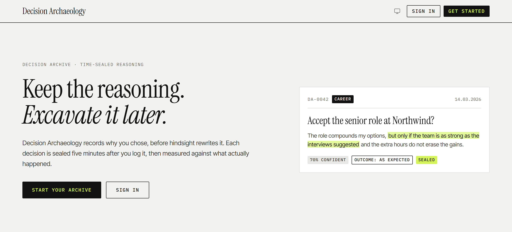

# Decision Archaeology

**A decision journal that seals your reasoning before hindsight can rewrite it.**

[](https://decision-archaeology.vercel.app/)


<picture>
  <source media="(prefers-color-scheme: dark)" srcset="assets/readme/hero-dark.png">
  
</picture>

## The idea

People remember how a decision turned out, but rarely why they made it. Once the outcome is known, memory quietly edits the reasoning to fit.

Decision Archaeology captures your reasoning while the decision is still live, then seals it on the server five minutes later. Every outcome you log afterwards sits beside the original record instead of replacing it. Over time, the archive shows how well your thinking predicted reality.

## How it works

1. **Capture before hindsight.** A guided form asks for the context, the alternatives, the option you chose and why, plus optional values, uncertainties, a predicted outcome and a confidence level. Drafts autosave every 30 seconds and can be resumed later.
2. **Seal.** Five minutes after you finalize, the core fields lock on the server. Typos can still be fixed through correction requests that keep an audit trail, but the reasoning itself cannot be rewritten. Each sealed record gets a catalog number such as `DA-0042`.
3. **Excavate.** Log outcomes as they arrive, rated against what you expected. Every update is kept. Calibration shows how often your confidence matched reality, and once you have ten decisions, AI pattern reports surface recurring biases and assumptions.

## Engineering highlights

- **Integrity lives on the server.** The UI only shows the countdown: the API classifies every edit (notes, draft, finalize or core) and rejects core changes once the window closes (`src/lib/locks.ts`, `src/lib/decision-patch.ts`). Corrections are limited to typo-sized edits (`src/lib/corrections.ts`).
- **One AI client, routed and validated.** All AI calls go through OpenRouter's Auto Router (`openrouter/auto`) in `src/lib/ai.ts`. Every pass sets its own cost tier, requests strict JSON Schema output generated from Zod schemas, is validated again with Zod, and gets one repair retry. The report pipeline extracts assumptions in parallel batches (low tier), runs bias detection (medium) and calibration analysis (low) at the same time, then synthesizes (high). The models the router actually picked are stored on the report and shown to the user.
- **Catalog numbers that never collide.** Numbers are assigned inside the finalize or import write, backed by a unique `(userId, catalogNumber)` constraint with one retry on a clash. The migration backfilled existing records in creation order (`src/lib/catalog.ts`, `src/lib/catalog-db.ts`).
- **A design system enforced by tests.** Every color is defined once in `src/lib/design/tokens.ts` and mirrored as CSS variables for light and dark mode. The test suite checks that every text and background pairing meets WCAG AA (4.5:1), keeps the CSS in sync with the tokens, bans raw palette classes, hex values and emoji in components, and flags text that could overflow on a phone. A small script in `<head>` applies the saved theme before first paint, so there is no flash.
- **Signed background jobs.** Reminder and report jobs run through Upstash QStash, and the job endpoints reject any request without a valid QStash signature (`src/lib/jobs.ts`).

## Features

- Multi-step capture with draft autosave and resume
- Five-minute seal with typo-only corrections and an audit trail
- Outcome history where every update is kept
- Calibration overall and by domain
- AI pattern reports with bias findings and calibration patterns, plus a way to flag findings that are wrong
- Sharing with collaborators: a read-only view, comments and check-in requests
- Up to five attachments per decision, stored in Cloudflare R2
- Archive search and filters
- Export as JSON or Markdown, and import past decisions from JSON or CSV templates (imported records are marked as imported and are not sealed)
- Light, dark and system themes

## Tech stack

| Layer | Choice |
| --- | --- |
| Framework | Next.js 16 (App Router), React 19, TypeScript |
| Styling | Tailwind CSS 4 with custom tokens and primitives, lucide-react icons, Instrument Serif, Inter Tight and IBM Plex Mono |
| Data | PostgreSQL (Neon), Prisma 7 with the `pg` adapter, Zod 4 validation |
| Auth | Clerk, with users synced to the database by a Svix-verified webhook |
| AI | OpenRouter Auto Router |
| Jobs and email | Upstash QStash, Resend |
| Files | Cloudflare R2 through the S3 API |
| Quality | Vitest 4, Testing Library, ESLint, Prettier |

## Run it locally

You need Node.js 20 or newer, a PostgreSQL database and a Clerk application. The AI, email, job and attachment services are only needed for the features that use them.

```bash
git clone https://github.com/atikulmunna/decision-archaeology.git
cd decision-archaeology
npm install
cp .env.example .env.local
npx prisma generate
npx prisma migrate deploy
npm run dev
```

Then open `http://localhost:3000`.

| Variables | Used for |
| --- | --- |
| `NEXT_PUBLIC_CLERK_PUBLISHABLE_KEY`, `CLERK_SECRET_KEY`, `CLERK_WEBHOOK_SECRET` | Sign-in and syncing users into the database |
| `DATABASE_URL`, `NEXT_PUBLIC_APP_URL` | The database and the app's public URL |
| `OPENROUTER_API_KEY`, `OPENROUTER_COST_TIER`, `OPENROUTER_ALLOWED_MODELS` | AI pattern reports. The allowed models list is optional, for example `anthropic/*` |
| `RESEND_API_KEY`, `RESEND_FROM_EMAIL` | Share invites, outcome notices, check-ins and reminders |
| `QSTASH_TOKEN`, `QSTASH_CURRENT_SIGNING_KEY`, `QSTASH_NEXT_SIGNING_KEY` | Background jobs. The signing keys are required in production |
| `R2_ACCESS_KEY_ID`, `R2_SECRET_ACCESS_KEY`, `R2_ENDPOINT_URL`, `R2_BUCKET_NAME`, `R2_PUBLIC_URL` | Attachments |

`.env.example` lists every variable with comments. Keep real values in `.env.local`, which is never committed.

### Checks

```bash
npm test            # Vitest: unit, component and guard tests
npx tsc --noEmit    # type check
npm run lint        # ESLint
npm run build       # production build
```

## Project layout

```text
prisma/                 schema and migrations
src/app/                pages, layouts and API route handlers
src/components/ui/      design system primitives (Button, Card, Badge, Callout, ...)
src/components/shell/   masthead, theme toggle and page containers
src/components/         feature components (decisions, sharing, reports, ...)
src/lib/                domain logic: locks, corrections, catalog, calibration, AI
src/lib/design/         tokens, theme and contrast helpers
src/__tests__/          tests, including the design, wrap and copy guards
```

## Roadmap

The project is being rebuilt as a portfolio piece in phases. Each phase ships working, tested software.

- [x] Integrity foundations: lock bypass closed, corrections hardened, job endpoints authenticated
- [x] OpenRouter Auto Router with schema-validated outputs
- [x] Field Archive design system and a reskin of every page
- [ ] A public demo archive you can explore without an account
- [ ] A cryptographic seal on every locked record that anyone can verify in the browser
- [ ] Then vs Now: sealed reasoning side by side with what actually happened
- [ ] Probabilistic forecasts with a Brier score and a reliability curve
- [ ] Strata Timeline: the archive drawn as geological layers
- [ ] Field Notes: a quick journal that feeds into decisions
- [ ] Devil's Advocate: pointed AI questions before you seal
- [ ] Letters to your future self and a guided revisit flow
- [ ] A case study page, end-to-end tests and demo recordings

## Deployment

The app is built for Vercel:

1. Import the repository into Vercel and add the environment variables above.
2. Set `NEXT_PUBLIC_APP_URL` to the deployed domain.
3. Point a Clerk webhook at `/api/webhooks/clerk`.
4. Run `npx prisma migrate deploy` against the production database before the new build goes live.

[`docs/VERCEL_DEPLOYMENT.md`](docs/VERCEL_DEPLOYMENT.md) has the full walkthrough.

<details>
<summary>Troubleshooting</summary>

**Sign-in works, but the app fails afterwards.** The Clerk webhook has probably not created the database user. Check that the webhook is enabled, that `CLERK_WEBHOOK_SECRET` matches, and that the migrations have run.

**"Lock it in" fails.** Check the `/api/decisions` function logs. The usual causes are an unsynced user or a database that is missing the latest migration.

**Attachments fail.** Check the four `R2_*` credentials and that the bucket exists.

**AI reports fail.** Check `OPENROUTER_API_KEY`. If you set `OPENROUTER_ALLOWED_MODELS`, make sure the patterns match models that support structured outputs.

</details>

## License

No license has been chosen yet, so all rights are reserved by default.
