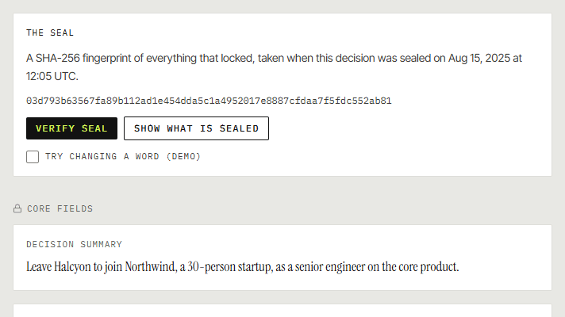

# Decision Archaeology

Keep the reasoning. Excavate it later. A decision journal that seals why you chose before hindsight can rewrite it, then measures it against what actually happened.

[](https://decision-archaeology.vercel.app/)
[](LICENSE)


**[Take the 60-second tour](https://decision-archaeology.vercel.app/demo?tour=1)** · [Read the case study](https://decision-archaeology.vercel.app/how-it-works) · [Open the live demo](https://decision-archaeology.vercel.app/)



## What it is

Decision Archaeology records a decision while it is still live: the options, the reasoning, what you expect and how sure you are. Five minutes later the record is sealed with a SHA-256 fingerprint that anyone can recheck in the browser. As outcomes arrive, the sealed record sits beside them, so you learn from what you actually thought rather than from what you remember thinking.

- **The seal.** Every locked field goes into a canonical payload; Verify recomputes its hash locally, and changing one word breaks it.
- **Then vs Now.** The sealed record beside what happened, with a verdict on each assumption and a score for each forecast.
- **The strata.** The whole archive drawn as layers of time, one lane per domain, with outcomes settled above their decisions.

The demo is the archive of Rowan Hale, a fictional engineer turned founder, and needs no account.

## Engineering highlights

- **Verifiable seals:** four versioned canonical payloads hashed with Web Crypto on the server and in the browser, so every older seal still verifies byte for byte.
- **Rules on the server:** a five-minute lock, audited typo corrections, and conditional writes so a late autosave never lands on a sealed record.
- **Schema-checked AI:** one OpenRouter client with strict JSON Schema generated from Zod, revalidation and a single repair, crediting the model that answered.
- **Honest calibration:** yes or no forecasts with stated probabilities, scored with a Brier score and reliability bands.
- **Tested at every layer:** Vitest unit and component suites, source scans for privacy and style, and Playwright smoke tests against a production build.

## Stack

Next.js 16 (App Router), React 19, TypeScript, Prisma 7 on PostgreSQL (Neon), Clerk, Tailwind CSS 4, OpenRouter, Resend, Upstash QStash, Vercel.

## Run locally

You need Node.js 20 or newer, a PostgreSQL database and a Clerk application. `.env.example` lists every variable with comments; the AI, email, job and attachment services are only needed for the features that use them.

```bash
git clone https://github.com/atikulmunna/decision-archaeology.git
cd decision-archaeology
npm install
cp .env.example .env.local
npx prisma generate
npx prisma migrate deploy
npm run dev              # http://localhost:3000
```

Checks:

```bash
npm test                 # Vitest: unit, component and guard tests
npx tsc --noEmit         # type check
npm run lint             # ESLint
npm run e2e              # Playwright smoke tests: builds, serves on port 3100, uses your installed Chrome
npm run record           # re-records docs/media (needs a production server on port 3100)
```

## Documentation

- [How it works](https://decision-archaeology.vercel.app/how-it-works): the case study, with live components from the demo
- [Architecture](docs/architecture.md): route groups, the data model and the client and server boundary
- [The seal](docs/the-seal.md): the canonical payload, its four versions and what a seal does not prove
- [Calibration](docs/calibration.md): forecasts, the Brier score and reliability bands
- [AI pipelines](docs/ai.md): the OpenRouter client, pattern reports and the Devil's Advocate
- [Testing](docs/testing.md): the suites, the guards and the smoke tests
- [Deploying to Vercel](docs/VERCEL_DEPLOYMENT.md)

## License

[MIT](LICENSE)
